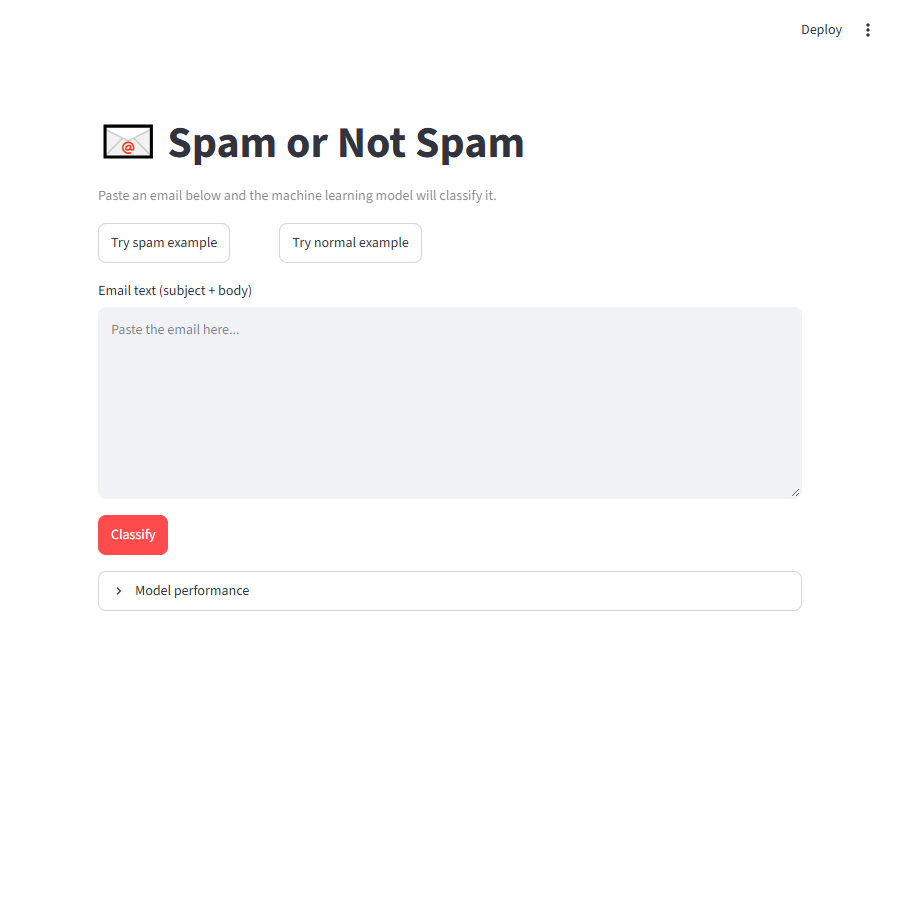
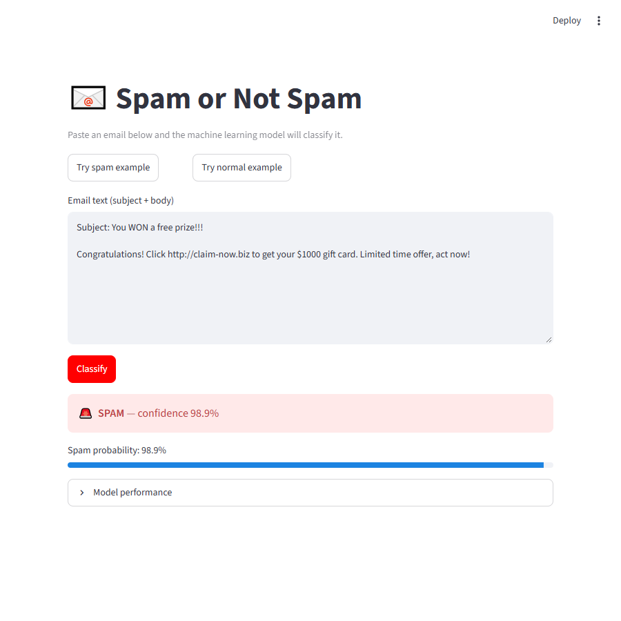
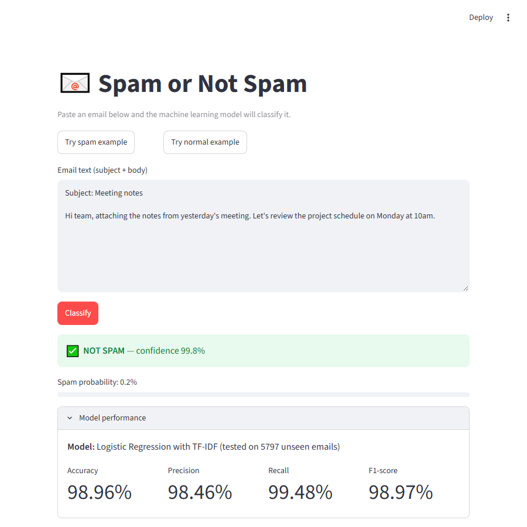

# 📧 Spam or Not Spam — Email Classification

A machine learning web app that reads the text of an email and predicts whether it is **Spam** or **Not Spam (legitimate)**.

**Live app:** _add your Streamlit link here_
**GitHub:** _add your repository link here_

Input: email text → Process: NLP preprocessing + TF-IDF + ML model → Output: Spam / Not Spam

## Dataset
[Enron-Spam dataset](https://github.com/MWiechmann/enron_spam_data) — 33,716 real emails labelled `spam` or `ham` (columns: Message ID, Subject, Message, Spam/Ham, Date). It is included in `data/enron_spam_data.zip`. After removing empty and duplicate emails, 28,981 remained (roughly 50/50 spam and not spam).

## Project parts
1. **Data collection:** explored columns and labels and printed sample spam and ham emails (`train.py`).
2. **Preprocessing:** subject and body are combined, lowercased, URLs and email addresses replaced by tokens, and symbols and digits removed (`preprocess.py`). Text is converted to numbers using **TF-IDF** (unigrams and bigrams, English stop words removed).
3. **Model:** Naive Bayes and Logistic Regression were trained on 80% of the data and tested on 20% unseen emails. The better model by F1-score was saved.
4. **App:** a Streamlit interface where the user pastes an email and gets the prediction with a confidence value.

## Results (5,797 unseen test emails)
| Model | Accuracy | Precision | Recall | F1 |
|---|---|---|---|---|
| Naive Bayes | 98.9% | 98.9% | 98.9% | 98.9% |
| **Logistic Regression** (used in app) | 99.0% | 98.5% | 99.5% | 99.0% |

Exact values are saved in `models/metrics.json`.

## Project structure
```
app.py              Streamlit web app
train.py            data loading, training, evaluation, model saving
preprocess.py       text cleaning shared by training and the app
requirements.txt    dependencies
data/               dataset (zip)
models/             saved model + metrics
screenshots/        screenshots of the working app
```

## Setup and run
```bash
git clone <your-repo-link>
cd <repo-folder>
pip install -r requirements.txt

# optional: retrain the model
python train.py

# start the app
streamlit run app.py
```
Open http://localhost:8501, paste an email and click **Classify**.

## Technologies
Python, Pandas, NumPy, Scikit-learn, TF-IDF, Streamlit, Git/GitHub.

## Screenshots



